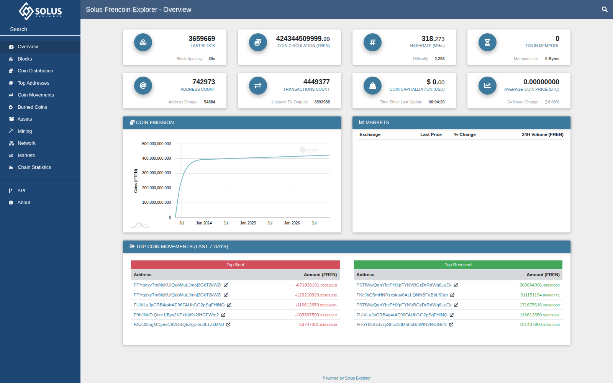

# Solus Explorer

Solus Explorer is a self-hosted block explorer for Bitcoin-derived blockchains,
written in plain PHP with MongoDB as its database. A cron-driven loader reads blocks
from the coin's own daemon over JSON-RPC and indexes them, including rollback data
for reorgs. Apache with mod_php serves the pages and a public JSON API. One checkout
serves one coin; everything coin-specific lives in a single `settings.php`.

## Project status

Support for this code base is ending:

* until 30 November 2026, issues, pull requests and security reports are answered;
* from 1 December 2026, support is best-effort: reports are read, but an answer or a
  fix is not guaranteed;
* support ends no later than 31 January 2027. The repository then stays available
  as is, without maintenance. To keep developing the code, fork it.



## Features

* Blocks, transactions, addresses and the mempool, with OP_RETURN payloads, multisig,
  P2PK, SegWit (bech32/bech32m) and cold-stake outputs decoded.
* Address groups (common-input clustering), top addresses, coin distribution and
  coin movements.
* Proof-of-work, proof-of-stake and hybrid reward schemes, with masternode and
  developer-fee payouts split out of the reward transaction.
* Masternode, staking, mining and network (peer) pages, plus chain statistics
  charts.
* Ravencoin-style assets: asset pages, asset movements and IPFS messages.
* Burned coins and exchange market data, each switchable per coin.
* A public HTTP API with rate limiting, and an admin area with a host and daemon
  dashboard and usage statistics.
* Reorg handling: every indexed block keeps undo data, orphaned blocks are rolled
  back automatically, and every loader stop is logged and reported to monitoring.
* Skins: one stylesheet driven by CSS variables, with your own logo, colours and
  side-menu image.

## Supported chains

Any daemon that keeps the Bitcoin Core RPC interface (`getblock`, `getrawtransaction`
with `txindex=1`, `getblockhash`, `getblockcount`). Both the older `addresses` and the
Bitcoin Core 22+ `address` output format are read; a Bitcoin Core 27.1 regtest chain with
legacy, P2SH-SegWit, SegWit, Taproot, bare multisig and OP_RETURN outputs indexes with
the same received totals and balances as the daemon. There are settings templates for
three families:

| Template | Family |
|---|---|
| `settings/settings.php.example` | proof-of-work chains (Bitcoin, Litecoin, Dogecoin and their forks) |
| `settings/settings.php.example-pos` | proof-of-stake chains with masternodes (PIVX and Dash family, DIP2 special transactions) |
| `settings/settings.php.example-assets` | asset-enabled chains (Ravencoin family) |

Reward layouts such as `PoW+MN+DEV` or `PoS+MN` are set per coin with `block_schemes`
(see [docs/configuration.md](docs/configuration.md#block-reward-schemes-block_schemes)).

## Requirements

| Component | Version |
|---|---|
| OS | Ubuntu 22.04 or 24.04 (Debian works the same way) |
| PHP | 8.1 to 8.4, with the `mongodb`, `decimal`, `curl`, `json`, `ctype`, `hash` and `readline` extensions (`decimal` needs libmpdec) |
| Web server | Apache 2.4 with mod_php (prefork); nginx and PHP-FPM are not supported |
| Database | MongoDB 6.0, 7.0 or 8.0 (8.0 on Ubuntu 24.04); x86 CPUs need AVX |
| Coin daemon | fully synced, with `txindex=1` and RPC reachable on 127.0.0.1 |
| Hardware | 2 vCPU, 4 GB RAM and an SSD; the database needs about 1.5 to 3 times the size of the chain |

No Composer packages or JavaScript build step are needed.

## Quick start

The full walk-through with every command is [docs/installation.md](docs/installation.md).
In short, as root on a fresh host:

1. **Install the stack.** Install MongoDB, then PHP with the extensions above and
   Apache ([installation.md sections 2 to 4](docs/installation.md#2-operating-system-preparation)).
2. **Run the coin daemon.** Start it with `txindex=1` and RPC on 127.0.0.1, and let
   it sync fully ([section 5](docs/installation.md#5-coin-daemon)).
3. **Check out the code and configure it:**
   ```bash
   cd /var/www && git clone https://github.com/cryptoscope-io/solus-explorer.git <sym> && cd <sym>
   cp settings/settings.php.example settings.php   # or -pos / -assets
   nano settings.php                               # database, RPC, genesis hash, address prefixes
   chown root:www-data settings.php && chmod 640 settings.php
   ```
   The keys you must set are listed in [section 7](docs/installation.md#7-settingsphp).
4. **Create the database user and the virtual host.** Follow
   [sections 8 and 9](docs/installation.md#8-database-collections-admin-user); the web
   root is `public/`. Section 8 also describes `script/create.php`, which automates
   these steps and skips whatever already exists.
5. **Index the chain and schedule the loaders:**
   ```bash
   cd /var/www/<sym>/script
   php loaderMongo-blocks.php 1000    # first run creates the collections, then indexes 1000 blocks
   php loaderMongo-metrics.php
   ```
   Then create the admin user (`php createAdminUser.php`), add the two cron lines
   from [section 11](docs/installation.md#11-cron), and check the result against the
   [verification checklist](docs/installation.md#13-verification-checklist).

## Documentation

[docs/](docs/README.md) covers how the pieces fit together:

* [installation](docs/installation.md) and [configuration](docs/configuration.md);
* [integration](docs/integration.md) (reverse proxies, several coins on one host, branding);
* [operations](docs/operations.md) (loaders, reorgs, logs, upgrades, troubleshooting);
* the [HTTP API](docs/api.md).

## Contributing and security

* To contribute, see [CONTRIBUTING.md](CONTRIBUTING.md).
* Do not report vulnerabilities in public issues; follow [SECURITY.md](SECURITY.md).

## License

Solus Explorer is released under the [MIT License](LICENSE). Bundled and CDN-loaded
third-party components keep their own licenses, listed in
[THIRD-PARTY-NOTICES.md](THIRD-PARTY-NOTICES.md).
